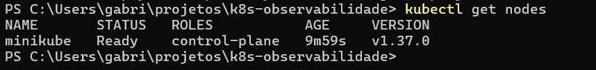

# 🛠️ Guia de Instalação

Passo a passo para preparar o ambiente e subir o projeto em um cluster Kubernetes local com **Minikube**.

> Ambiente usado nos testes: **Windows 11** · notebook com 16 GB de RAM e Intel Core i3 (2 núcleos / 4 threads).

---

## 1. Pré-requisitos

| Ferramenta | Versão testada | Para que serve |
|---|---|---|
| Docker Desktop (backend WSL2) | 4.94.0 (Engine 29.8.2) | Executa os contêineres e serve de driver para o Minikube |
| kubectl | v1.36.1 | Cliente de linha de comando do Kubernetes |
| Minikube | v1.39.0 | Cria o cluster Kubernetes local (1 nó) |
| Helm | v4.3.2 | Gerenciador de pacotes do Kubernetes (instala Prometheus + Grafana) |
| Git | qualquer | Versionamento do projeto |

## 2. Instalação das ferramentas (Windows)

1. Instale o **Docker Desktop** marcando a opção *"Use WSL 2 instead of Hyper-V"*. Abra o programa e aguarde **"Engine running"**.
2. No PowerShell, instale o restante com o `winget`:

```powershell
winget install Kubernetes.kubectl
winget install Kubernetes.minikube
winget install Helm.Helm
```

> ⚠️ O instalador do Minikube pede permissão de administrador (UAC). Se a janela for fechada, a instalação falha com o erro `0x800704c7`. Basta rodar o comando novamente e clicar em **Sim**.

3. Feche e reabra o terminal e confira as versões:

```powershell
docker version
kubectl version --client
minikube version
helm version
```

> 💡 **Linux/macOS:** as mesmas ferramentas podem ser instaladas pelo gerenciador de pacotes do sistema (`apt`, `brew`) ou pelas instruções oficiais de cada projeto. Os demais comandos deste guia são iguais.

## 3. Liberar recursos para o Docker (WSL2)

Por padrão o WSL2 pode limitar a memória e as CPUs do Docker. Na primeira tentativa o Minikube recusou subir:

```
RSRC_INSUFFICIENT_CORES: A quantidade de cpu solicitada 4 é maior que as cpus disponíveis de 2
MK_USAGE: O Docker Desktop tem apenas 2910MB de memória, mas você especificou 6144MB
```

**Solução:** criar o arquivo `%USERPROFILE%\.wslconfig`:

```ini
[wsl2]
memory=8GB
processors=4
```

Depois reiniciar o WSL e o Docker Desktop:

```powershell
wsl --shutdown
# feche e abra o Docker Desktop novamente
docker info   # conferir "CPUs: 4" e "Total Memory: ~7.7GiB"
```

## 4. Iniciar o cluster Minikube

```powershell
minikube start --driver=docker --cpus=4 --memory=6144
```

| Parâmetro | Motivo |
|---|---|
| `--driver=docker` | O cluster roda dentro de um contêiner do Docker Desktop |
| `--cpus=4` | Usa os 4 núcleos lógicos disponíveis |
| `--memory=6144` | 6 GB: suficiente para a aplicação + stack de observabilidade |

Verificar se o nó está pronto:

```powershell
kubectl get nodes
```

```
NAME       STATUS   ROLES           AGE   VERSION
minikube   Ready    control-plane   83s   v1.37.0
```



## 5. Subir o projeto

### Opção A — script automático (recomendado)

Na raiz do repositório:

```powershell
powershell -ExecutionPolicy Bypass -File .\setup.ps1
```

O script executa, em ordem, todos os passos da Opção B.

### Opção B — passo a passo manual

```powershell
# 1. Namespaces (app = aplicação e banco | monitoring = observabilidade)
kubectl apply -f k8s/namespaces.yaml

# 2. Banco de dados: Secret, PVC, Deployment e Service
kubectl apply -f k8s/banco/banco-secret.yaml
kubectl apply -f k8s/banco/banco-pvc.yaml
kubectl apply -f k8s/banco/banco-deployment.yaml
kubectl apply -f k8s/banco/banco-service.yaml

# 3. Loki, Tempo e OpenTelemetry Collector
kubectl apply -f k8s/observabilidade/loki.yaml
kubectl apply -f k8s/observabilidade/tempo.yaml
kubectl apply -f k8s/observabilidade/otel-collector.yaml

# 4. Prometheus + Grafana via Helm
helm repo add prometheus-community https://prometheus-community.github.io/helm-charts
helm repo update
helm upgrade --install kps prometheus-community/kube-prometheus-stack `
  -n monitoring -f k8s/observabilidade/helm/values-kube-prometheus-stack.yaml
kubectl apply -f k8s/observabilidade/app-servicemonitor.yaml

# 5. Build da imagem da aplicação e envio para o Minikube
docker build -t tarefas-app:1.0 ./app
minikube image load tarefas-app:1.0

# 6. Aplicação: ConfigMap, Deployment (2 réplicas) e Service
kubectl apply -f k8s/app/app-configmap.yaml
kubectl apply -f k8s/app/app-deployment.yaml
kubectl apply -f k8s/app/app-service.yaml
```

## 6. Verificar

```powershell
kubectl get pods -n app
kubectl get pods -n monitoring
```

Todos os pods devem ficar com status **Running** (a aplicação Java pode levar 1–2 minutos para ficar `1/1`).

Para acessar a aplicação e o Grafana, veja a seção **"Como acessar"** do [README.md](README.md).

## 7. Desligar / remover

```powershell
minikube stop      # desliga o cluster e libera memória (mantém tudo)
minikube delete    # apaga o cluster por completo
```
