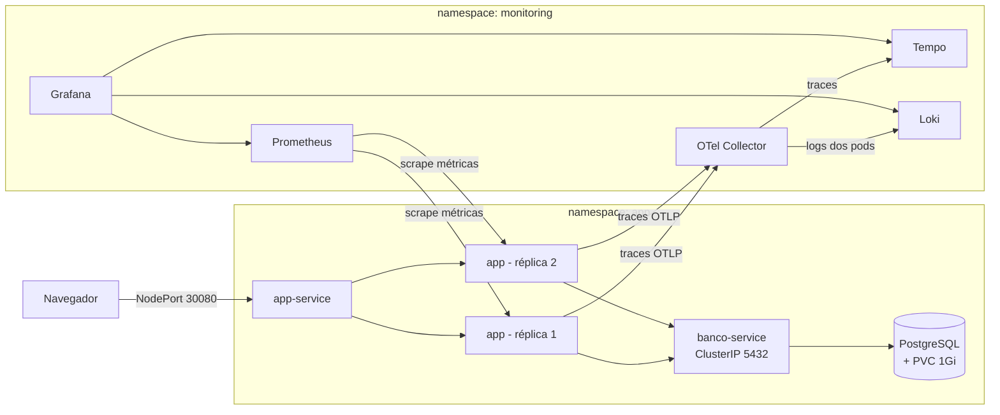
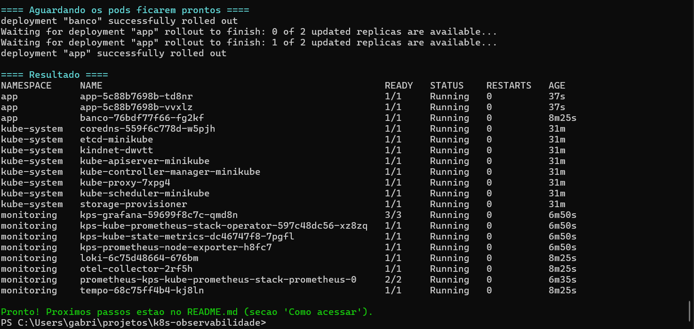
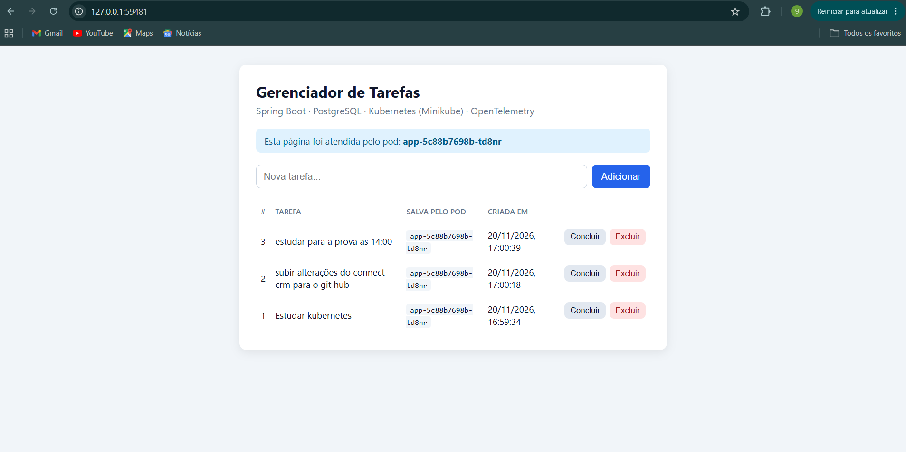
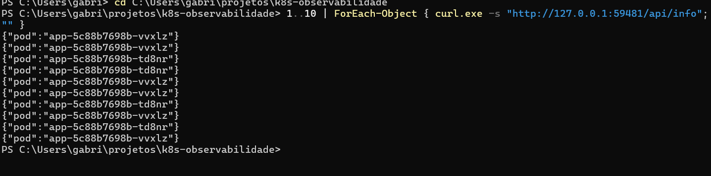
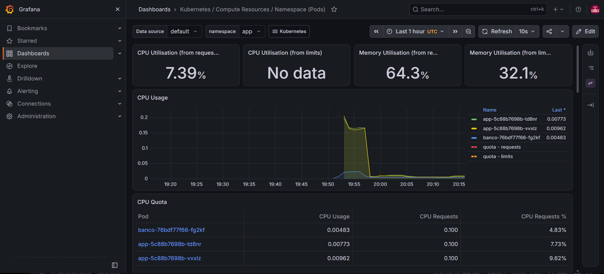
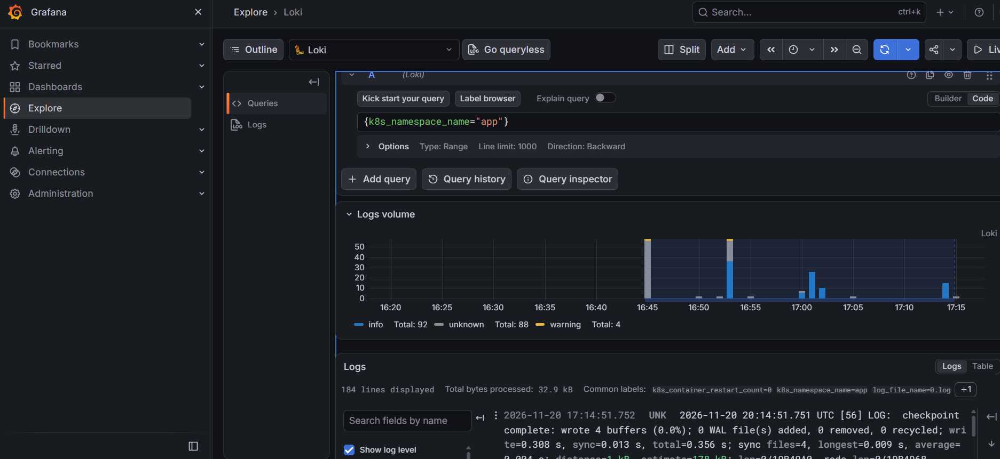
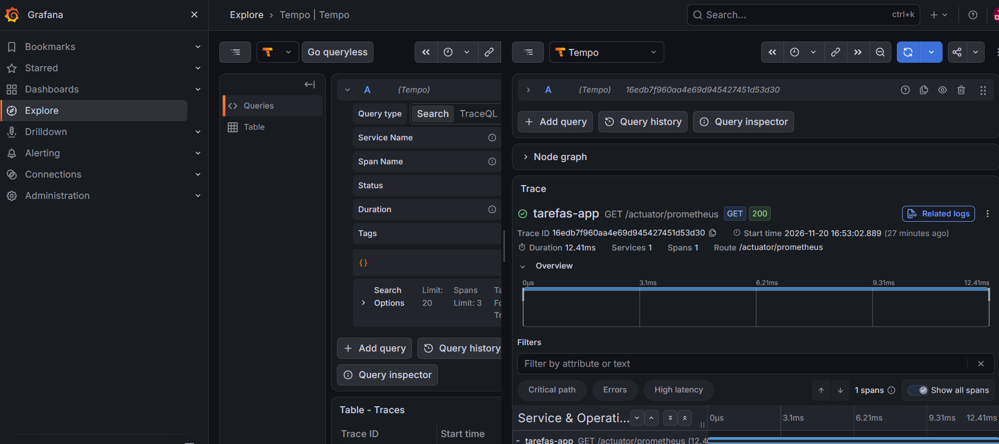

# ☸️ Kubernetes na Prática — Tarefas App + Observabilidade

Projeto prático de Kubernetes com **Minikube**: um banco de dados PostgreSQL, uma aplicação web Java **replicada (2 pods)** conectada a esse banco e uma stack completa de observabilidade com **Prometheus, Loki, Tempo, OpenTelemetry e Grafana**.

> 📄 Instalação do ambiente e comandos para subir o projeto: **[INSTALL.md](INSTALL.md)**

---

## 📌 A aplicação

**Tarefas App** é um gerenciador de tarefas (to-do list) feito para este laboratório:

- **Back-end:** Java 21 + Spring Boot 3.5 (Web, JDBC, Actuator)
- **Banco:** PostgreSQL 16
- **Front-end:** página HTML/JS servida pelo próprio Spring Boot

**Funcionalidades:**

| Operação | Endpoint | Banco de dados |
|---|---|---|
| Listar tarefas | `GET /api/tarefas` | `SELECT` |
| Criar tarefa | `POST /api/tarefas` | `INSERT` |
| Concluir / reabrir | `PUT /api/tarefas/{id}/concluir` | `UPDATE` |
| Excluir | `DELETE /api/tarefas/{id}` | `DELETE` |
| Qual pod atendeu | `GET /api/info` | — |

Cada tarefa grava **o nome do pod que a salvou** (coluna "Salva pelo pod"), e a página mostra qual pod atendeu a requisição. Assim fica visível na própria tela que as **duas réplicas** atendem usuários e escrevem no **mesmo banco**.

---

## 🏗️ Arquitetura



| Componente | Papel | Como foi instalado |
|---|---|---|
| **Prometheus** | Métricas do cluster, dos pods e da aplicação (`/actuator/prometheus`) | Helm (`kube-prometheus-stack`) |
| **Grafana** | Dashboards e consulta de métricas, logs e traces | Helm (`kube-prometheus-stack`) |
| **OpenTelemetry** | Agente Java gera os traces (HTTP + JDBC) sem alterar o código; o **Collector** recebe os traces e coleta os logs de todos os pods | Manifesto (`otel-collector.yaml`) |
| **Tempo** | Armazena os traces | Manifesto (`tempo.yaml`) |
| **Loki** | Armazena e indexa os logs | Manifesto (`loki.yaml`) |

---

## 📁 Estrutura do repositório

```
.
├── app/                         # Código da aplicação (Spring Boot) + Dockerfile
├── k8s/
│   ├── namespaces.yaml          # namespaces "app" e "monitoring"
│   ├── banco/
│   │   ├── banco-secret.yaml    # credenciais do PostgreSQL
│   │   ├── banco-pvc.yaml       # volume persistente (1Gi)
│   │   ├── banco-deployment.yaml
│   │   └── banco-service.yaml   # ClusterIP 5432
│   ├── app/
│   │   ├── app-configmap.yaml   # DB_HOST=banco-service + config OpenTelemetry
│   │   ├── app-deployment.yaml  # replicas: 2
│   │   └── app-service.yaml     # NodePort 30080
│   └── observabilidade/
│       ├── helm/values-kube-prometheus-stack.yaml  # Prometheus + Grafana (+ datasources Loki/Tempo)
│       ├── loki.yaml
│       ├── tempo.yaml
│       ├── otel-collector.yaml
│       └── app-servicemonitor.yaml
├── docs/evidencias/             # capturas de tela
├── setup.ps1                    # sobe tudo com um comando
├── INSTALL.md
└── README.md
```

### Destaques dos manifestos

- **Banco:** credenciais em `Secret` (nada de senha no Deployment), dados em `PersistentVolumeClaim`, `readinessProbe` com `pg_isready` e estratégia `Recreate` (evita dois pods usando o mesmo volume).
- **Aplicação:** `replicas: 2`, conexão via `DB_HOST=banco-service` (DNS interno do Kubernetes), probes `startup`/`readiness`/`liveness` no Actuator e `requests`/`limits` de recursos.
- **Exposição:** `banco-service` é **ClusterIP** (só acessível dentro do cluster) e `app-service` é **NodePort** (acessível de fora e balanceando entre as réplicas).

---

## 🚀 Como acessar

> Pré-requisito: ambiente no ar conforme o [INSTALL.md](INSTALL.md).

### Aplicação

```powershell
minikube service app-service -n app --url
```

Abra a URL exibida no navegador (no Windows com driver Docker **deixe esse terminal aberto**, pois ele mantém o túnel).

### Grafana

Em outro terminal:

```powershell
kubectl port-forward -n monitoring svc/kps-grafana 3000:80
```

Acesse **http://localhost:3000**, com usuário `admin` e senha `admin123`.

---

## ✅ Validação e evidências

### 1. Pods rodando (2 réplicas da aplicação + banco)

```powershell
kubectl get pods -n app -o wide
kubectl get pods -n monitoring
```



### 2. Aplicação funcionando e gravando no banco

Cadastrar, concluir e excluir tarefas pela página. A coluna **"Salva pelo pod"** mostra qual réplica gravou cada registro no PostgreSQL.



Conferindo direto no banco:

```powershell
kubectl exec -it deploy/banco -n app -- psql -U tarefas -d tarefas -c "SELECT * FROM tarefas;"
```

### 3. Balanceamento de carga entre as réplicas

Cada execução do `curl.exe` abre uma conexão nova, e o Service distribui entre os pods:

```powershell
$url = "<URL do minikube service>"
1..10 | ForEach-Object { curl.exe -s "$url/api/info"; "" }
```

A resposta alterna entre os dois nomes de pod.



### 4. Grafana: métricas (Prometheus)

- **Dashboards → Kubernetes / Compute Resources / Namespace (Pods)**, namespace `app`: CPU e memória de cada pod.
- **Explore → Prometheus**, por exemplo:
  - `kube_pod_status_phase{namespace="app", phase="Running"}`: pods ativos
  - `sum by (pod) (rate(http_server_requests_seconds_count{namespace="app"}[1m]))`: requisições por pod



### 5. Grafana: logs (Loki)

**Explore → Loki**:

```logql
{k8s_namespace_name="app"}
```

Mostra os logs dos pods da aplicação (ex.: `Tarefa 3 criada ... - pod app-xxxx`) e do PostgreSQL.



### 6. Grafana: traces (Tempo + OpenTelemetry)

**Explore → Tempo → Search**, Service Name `tarefas-app`. Ao abrir um trace aparecem o span da requisição HTTP e, dentro dele, o span da **consulta SQL** ao PostgreSQL, gerados automaticamente pelo agente Java do OpenTelemetry.



---

## 🧯 Problemas encontrados e soluções

| Problema | Causa | Solução |
|---|---|---|
| `0x800704c7` ao instalar o Minikube | Janela de permissão (UAC) fechada | Rodar de novo e aceitar o UAC |
| `RSRC_INSUFFICIENT_CORES` / `MK_USAGE` (2910MB) | WSL2 limitando CPU e memória do Docker | Criar `.wslconfig` com `memory=8GB` e `processors=4` |
| `kubectl get pods` → `Unable to connect to the server` | Cluster ainda não criado | Rodar `minikube start` |

---

## 👥 Integrantes

- Gabriel Carvalho de Oliveira  e João Pedro Abdala — [GitHub](https://github.com/Dev-Gabrielcarvalho07)
